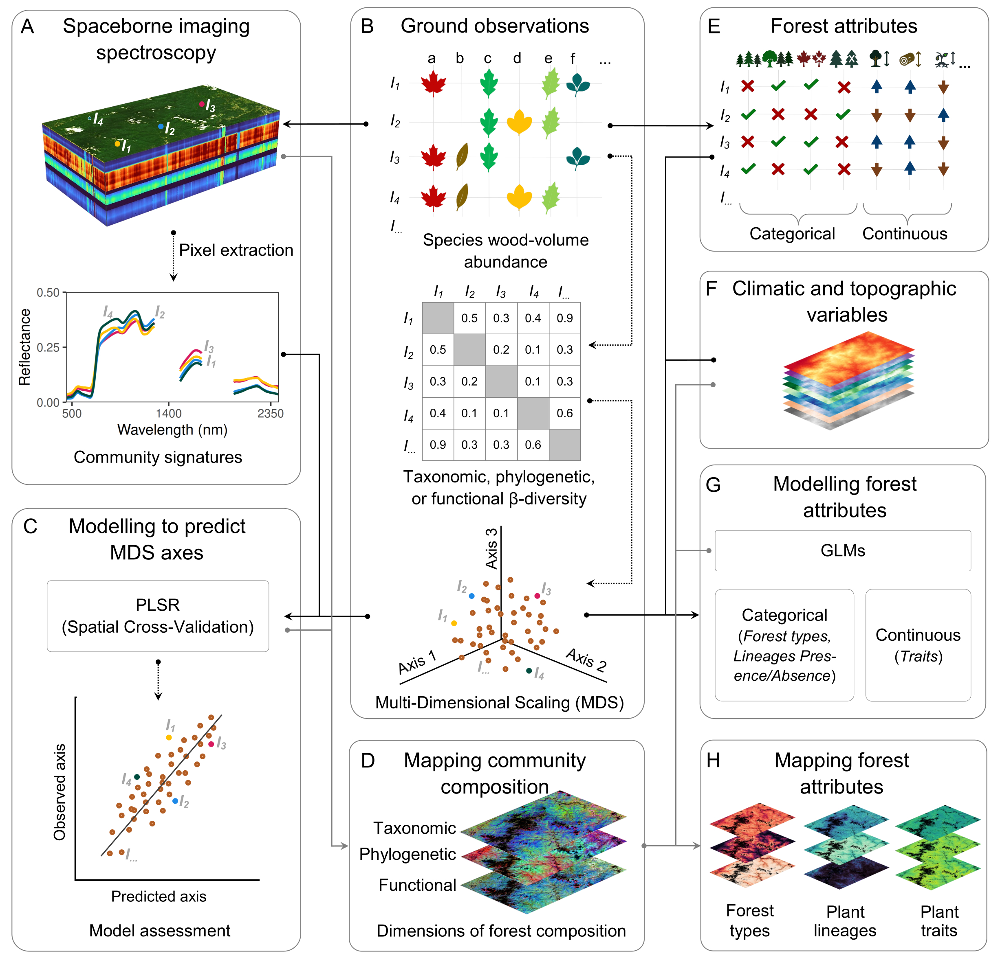

<div align="center">

<h1>Mapping multiple dimensions of forest diversity using spaceborne spectroscopy</h1>

[J. Antonio Guzmán Q.](https://orcid.org/0000-0002-0721-148X) <sup>1, 2, *</sup>, 
[Jonathan Knott](https://orcid.org/0000-0003-3856-8454) <sup>3</sup>, 
[Jesús N. Pinto-Ledezma](https://orcid.org/0000-0001-6668-9670) <sup>2</sup>, 
[Philip A. Townsend](https://orcid.org/0000-0001-7003-8774) <sup>4</sup>, 
[Jeannine Cavender-Bares](https://orcid.org/0000-0003-3375-9630) <sup>1, 2, °</sup>,  

<sup>1</sup> Department of Organismic and Evolutionary Biology, Harvard University, Cambridge MA 02138, USA
<sup>2</sup> Department of Ecology, Evolution, and Behavior, University of Minnesota, Saint Paul, MN 55108, USA.
<sup>3</sup> USDA Forest Service, Saint Paul, MN 55108, USA.
<sup>4</sup> Department of Forest and Wildlife Ecology, University of Wisconsin—Madison, Madison, WI 53706, USA.

</div>

<p align='center'>
  <a href="https://doi.org/10.32942/X24H1D"></a>
</p>

## Summary
Observing biodiversity across space and time is essential for advancing and verifying conservation efforts toward global biodiversity and sustainability goals. 
Spaceborne imaging spectroscopy has emerged as a revolutionary tool for quantifying and tracking forest diversity, yet its application at large spatial scales remains a central challenge. 
We develop a framework to map multiple dimensions of forest community composition and diversity by integrating imaging spectroscopy from two spaceborne sensors (DESIS and EMIT) with taxonomic, phylogenetic, and functional trait datasets, and 43,155 forest inventory plots across the Eastern United States. 
We demonstrate that imaging spectroscopy can be used to predict ordination axes of β-diversity and to map multiple dimensions of forest diversity at high spatial resolution (30 or 60 m). 
Predicted β-diversity axes can be used to model forest attributes, including forest types, plant lineages, and community plant traits, as well as evaluating temporal changes in community composition. 
Our framework shows that spaceborne imaging spectroscopy, when combined with inventory data, allows indirect yet comprehensive observation of forest diversity attributes across broad spatial extents. 
This integrative approach sets the stage for scalable forest monitoring in support of global biodiversity conservation and forthcoming satellite missions.

## Description of the repository

### Workflow

<p align="center">
  
</p>

**Framework for mapping forest community composition and its attributes using spaceborne imaging spectroscopy.** 
Forest inventory locations are first used to extract pixels from scenes (A). Species abundance data from inventories 
are then used to calculate pairwise β-diversity matrices (B), which are then ordinated using multi-dimensional scaling (MDS). 
The resulting axes of β-diversity are combined with spectral information to model (C) and map forest community composition (D). 
These axes are also paired with forest attributes (E) and climatic and topographic variables (F) to model (G) and map a range 
of forest types, plant lineages, and community plant traits (H). Together, this framework enables the spatial mapping of both 
forest community composition and associated forest attributes at large spatial extent. Black solid arrows represent the link 
between data sources for modelling, grey solid arrows the use of data sources and models for mapping, and black dotted arrows 
intermediate steps. 

### Project Structure

```
mapping-communities/
├── R/                                         # R scripts of the workflow (run in numeric order)
│   ├── FIA/                                   # Forest inventory (FIA) processing
│   │   ├── 01_FIA-cleaning.R                  # Clean and reshape FIA plots into community matrices
│   │   ├── 02_SPCD-functional.R               # Compile functional attributes of species
│   │   ├── 03_community-features.R            # Relative abundance and CWM of community features
│   │   └── 03_FIA-env.R                       # Extract climate (WorldClim) and topography (HYDRO1k) per plot
│   ├── Pixel_extraction/                      # Spectra extraction at inventory plots
│   │   ├── 01_pixel-extraction_*.R            # Extract and transform pixels from L2 scenes
│   │   ├── 02_compile-files_*.R               # Compile extracted pixels by scene and transformation
│   │   ├── 02_quality-assessment_*.R          # Quality assessment of extracted spectra
│   │   └── 03_match_stands-spectra_*.R        # Match spectra with inventory plots
│   ├── Diversity/                             # β-diversity, Mantel tests, and ordinations
│   │   ├── 01-beta_*.R                        # β-diversity matrices (Btotal, Brepl, Brich)
│   │   ├── 02_mantel_msr.R                    # Spatially-constrained Mantel tests (Moran Spectral Randomization)
│   │   ├── 03_landmark-MDS.R                  # Multi-Dimensional Scaling
│   │   ├── 03_MDS_goodness_of_fit.R           # Goodness-of-fit of MDS ordinations
│   │   ├── 03_MDS_post-processing.R           # Rotation and projection of species, traits, and environment
│   │   └── 04_MDS_correlations.R              # Correlations between MDS axes and forest attributes
│   ├── Models/                                # Modeling and mapping
│   │   ├── 01_model_beta.R                    # PLSR models to predict MDS axes from spectra
│   │   ├── 02_apply-model_*.R                 # Apply PLSR models to scenes
│   │   ├── 03_model-*.R                       # Model forest attributes from MDS axes
│   │   ├── 04_performance-*.R                 # Performance of models based on predicted axes
│   │   └── 05_apply-*.R                       # Map forest attributes from predicted axes
│   └── auxiliary/                             # Helper functions sourced by the scripts above
├── src/                                       # C++ (Rcpp/RcppArmadillo/RcppEigen) functions for HPC
├── figures/                                   # Scripts to reproduce manuscript and supplementary figures
├── slurm/                                     # SLURM job scripts for HPC clusters
├── data/                                      # Auxiliary data
├── static/                                    # Images for this README
├── mapping-species.Rproj                      # RStudio project
├── LICENSE                                    # GNU AGPL-3.0 License
└── README.md                                  # This file
```

## Citation

If you use the code from this repository, please cite the manuscript and the code:

> Guzmán J.A., Knott J., Pinto-Ledezma J.N., Townsend P.A., and Cavender-Bares J. (pending). Mapping multiple dimensions of forest diversity using spaceborne spectroscopy. *In review*. https://doi.org/pending

> Guzmán J.A., Knott J., Pinto-Ledezma J.N., Townsend P.A., and Cavender-Bares J. (pending). Mapping multiple dimensions of forest diversity using spaceborne spectroscopy (v1.0). *Zenodo*. https://doi.org/10.5281/zenodo.pending

### BibTeX Entries

#### Manuscript

```bibtex
@article{guzman_mapping_manuscript,
  author    = {Guzmán, J. A. and Knott, J. and Pinto-Ledezma, J. N. and Townsend, P. A. and Cavender-Bares, J.},
  title     = {Mapping multiple dimensions of forest diversity using spaceborne spectroscopy},
  journal   = {pending},
  year      = {pending},
  volume    = {pending},
  pages     = {pending},
  doi       = {pending}
}
```

#### Code

```bibtex
@software{guzman_mapping_code,
  author    = {Guzmán, J. A. and Knott, J. and Pinto-Ledezma, J. N. and Townsend, P. A. and Cavender-Bares, J.},
  title     = {Mapping multiple dimensions of forest diversity using spaceborne spectroscopy},
  year      = {pending},
  version   = {v1.0},
  publisher = {Zenodo},
  url       = {https://github.com/Antguz/mapping-communities},
  doi       = {10.5281/zenodo.pending}
}
```

## Acknowledgments 
We thank the German Aerospace Center (DLR) and the National Aeronautics and Space 
Administration (NASA) for providing access to DESIS and EMIT imagery for scientific 
research, respectively. We thank the numerous field crews and information management 
staff who collected and compiled the FIA data used in this study. Thanks to the Minnesota 
Supercomputing Institute and the Faculty of Arts and Sciences Research Computing for 
their high-performance infrastructure that allows us to conduct this research. 
This study was supported by the NASA Biodiversity Program (Award number: 80NSSC21K1349), 
the National Science Foundation (NSF) through ASCEND Biology Integration Institute 
(DBI: 2021898), the Harvard University Faculty of Arts and Sciences, and the 
Harvard University Salata Institute for Climate and Sustainability.

